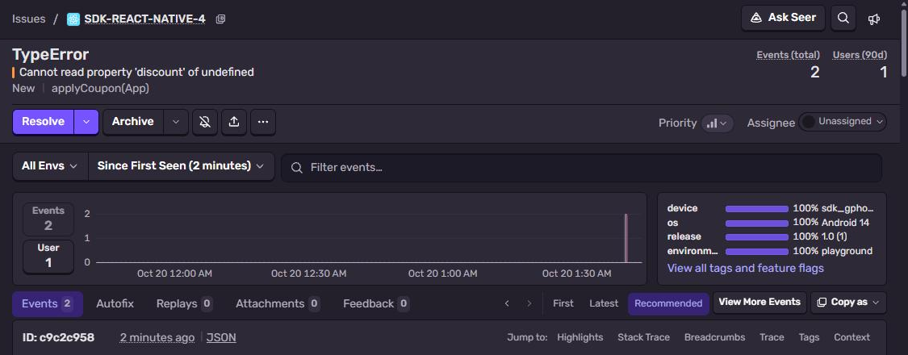
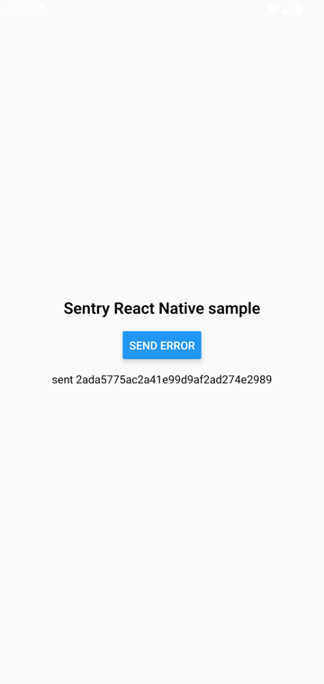
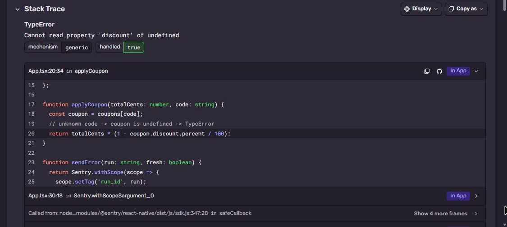

# Sentry + React Native

React Native 0.88 app (bare, no Expo), Android only here. The release bundle is minified Hermes bytecode,
the source map uploaded during the Gradle build gives back `App.tsx` with line numbers.
Part of [Sentry Playground](https://github.com/fsmaster/sentry-playground). The playground button runs the
workflow of this repo: build → emulator → error.



## What you need

- Node 22+, JDK 17, Android SDK (Android Studio), emulator or phone
- Sentry project with platform **React Native**
- Sentry auth token: **Settings → Auth Tokens → Create New Token**

## 1. Install and set DSN

```bash
git clone https://github.com/fsmaster/sentry-sample-react-native.git
cd sentry-sample-react-native
npm ci
```

Put your DSN into `App.tsx` (`Sentry.init({ dsn: ... })`) and your org/project into
`android/sentry.properties`:

```properties
defaults.url=https://sentry.io/
defaults.org=<your-org>
defaults.project=<your-project>
```

## 2. Build release

```bash
export SENTRY_AUTH_TOKEN=sntrys_...
cd android
./gradlew assembleRelease -PreactNativeArchitectures=x86_64
```

`-PreactNativeArchitectures=x86_64` only builds for emulator and is much faster, drop it for a phone.
End of the log:

```
Uploading sourcemaps for release com.sentrysample@1.0+1 distribution 1
> Uploaded files to Sentry
Source Map Upload Report
    ~/index.android.bundle (sourcemap at index.android.bundle.map, debug id 138392c4-...)
```

## 3. Run

```bash
adb install -r app/build/outputs/apk/release/app-release.apk
adb shell am start -a android.intent.action.VIEW -d "sentrysample://run?id=test-1" com.sentrysample
```

The deep link makes the app send one error on start. Or open it and tap **Send error**.



## 4. Check it in Sentry

**Issues** → `RangeError` from `Intl.NumberFormat` with a bad currency code. Top frame is `formatPrice`
in `App.tsx`, with the TypeScript source, not the minified bundle:



## How it works

Three places:

1. `App.tsx`: `Sentry.init({ dsn })` and `export default Sentry.wrap(App)`. `wrap` adds error boundary
   and touch breadcrumbs.
2. `metro.config.js`: `withSentryConfig(config)`. It writes a **Debug ID** into the bundle and the
   source map. Sentry matches them by this id, release name doesn't matter anymore.
3. `android/app/build.gradle`:
   ```groovy
   apply from: new File(["node", "--print", "require.resolve('@sentry/react-native/package.json')"].execute().text.trim(), "../sentry.gradle")
   ```
   This hooks into `assembleRelease`: after the JS bundle is built, it uploads bundle + source map.

The native side (Java/Kotlin crashes, ANRs) is covered too, `@sentry/react-native` includes the Android
SDK. Native crashes are sent on next start.

## CI

`.github/workflows/trigger.yml`: `npm ci` → `assembleRelease` (x86_64) → emulator API 34 → deep link with
the run id. Runs on push and `workflow_dispatch`.

## Troubleshooting

| Symptom | Why |
|---|---|
| Stack trace shows `index.android.bundle:1:23456` | Source map not uploaded (no token), or app built from different bundle. Look for "Source Map Upload Report" in the build log. |
| `node` not found during Gradle build | `sentry.gradle` path is resolved with `node`. Make sure node is in PATH of the shell running Gradle. |
| Works in debug, not release | In debug the JS is not minified and comes from Metro. Test source maps only with release build. |
